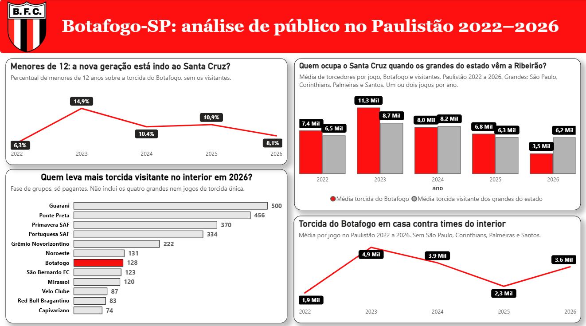

# Botafogo-SP: análise de público no Paulistão 2022–2026

Projeto de análise de dados feito por **Caio Missão**, com Python e Power BI.

## Pergunta central

**A torcida do Botafogo-SP está se afastando do clube?**

Desde 2018, o Botafogo-SP é gerido por uma SAF. Passados os primeiros anos de adaptação ao novo modelo e as dificuldades da pandemia, este projeto usa os dados oficiais de público do Paulistão para entender como a torcida tem respondido: se está comparecendo ao estádio ou se afastando do clube.

Para responder, o projeto olha a torcida por quatro lados:

1. A torcida está indo menos ao Estádio Santa Cruz?
2. Os jogos contra os grandes do estado (São Paulo, Corinthians, Palmeiras e Santos) ainda são lotados por botafoguenses?
3. As crianças estão indo ao estádio? (percentual de menores de 12 anos na torcida)
4. A torcida acompanha o time fora de casa, em comparação com outros clubes do interior?

## Fonte dos dados

- **Boletins financeiros da Federação Paulista de Futebol (FPF)**, em PDF, com público e renda de cada jogo, separados por setor.
- **Base 1 – Jogos do Botafogo-SP:** planilha montada manualmente, com os jogos do Paulistão de 2022 a 2026. Colunas: data, campeonato, rodada, mando de campo, adversário, gols, público total, renda, público e renda da torcida do Botafogo e público menor de 12 anos.
- **Base 2 – Torcida visitante dos clubes do interior:** extraída automaticamente de 48 boletins do Paulistão 2026 (fase de grupos), com um script em Python.
- **Contexto esportivo:** o Botafogo-SP disputou a Série C do Brasileirão em 2022, quando conseguiu o acesso, e de 2023 a 2026 vem jogando a Série B, sem grandes campanhas. O Paulistão de 2022 começou em 23 de janeiro com público limitado a 70% da capacidade dos estádios, exigência de comprovante de vacinação e uso obrigatório de máscara, por determinação do governo de São Paulo ([Folhapress, via Mix Vale](https://www.mixvale.com.br/2022/01/12/paulista-tera-limite-de-publico-de-70-e-exigira-vacinacao-diz-governo/)). A capacidade total só foi liberada em 9 de março, ainda com comprovante de vacinação ([Agência Brasil](https://agenciabrasil.ebc.com.br/geral/noticia/2022-03/governo-de-sp-libera-100-do-publico-em-jogos-de-futebol-nos-estadios)). Isso ajuda a explicar o público baixo do Botafogo-SP naquele ano. Informações pesquisadas em portais esportivos.

## Ferramentas

- **Excel:** coleta e organização manual da base de jogos do Botafogo-SP, a partir dos boletins da FPF.

* **Python (pandas):** leitura, limpeza, criação de colunas e análises exploratórias.
* **Python (pdfplumber e expressões regulares):** leitura automática dos boletins em PDF.
* **Power BI:** dashboard final.
* **VS Code:** ambiente de desenvolvimento.

- **IA generativa (Claude):** usada como assistente para escrever, corrigir e otimizar os códigos em Python (como a leitura dos PDFs com expressões regulares), organizar as análises e pesquisar o contexto esportivo. As perguntas da análise, a coleta dos dados, as decisões sobre exceções e a conferência dos números nos boletins foram feitas por mim.

## Etapas do projeto

### 1. Coleta dos dados (Excel)

- Download dos boletins financeiros de cada jogo do Botafogo-SP no Paulistão, no site da FPF.
- Registro manual, jogo a jogo, numa planilha do Excel: data, rodada, mando, adversário, gols, público, renda, torcida do Botafogo e menores de 12 anos.
- Nos jogos fora de casa, identificação do setor visitante de cada estádio para saber quantos torcedores do Botafogo viajaram.

* Nos jogos em casa, os menores de 12 anos foram identificados pela linha de gratuidade do boletim que cita a [Lei Municipal nº 13.953/2017](https://leismunicipais.com.br/a/sp/r/ribeirao-preto/lei-ordinaria/2017/1395/13953/lei-ordinaria-n-13953-2017-dispoe-sobre-acesso-gratuito-de-criancas-acompanhadas-dos-pais-ou-responsaveis-nas-dependencias-de-estadios-de-futebol-e-pracas-desportivas-no-municipio-de-ribeirao-preto-e-da-outras-providencias) de Ribeirão Preto, que garante entrada gratuita a crianças de até 12 anos acompanhadas dos pais ou responsáveis.

### 2. Preparação e análises (analise.py)

- Leitura da planilha com pandas.
- Criação da coluna **ano** a partir da data.
- Filtro de **2022 a 2026**.
- Classificação dos adversários em **Grandes** (os quatro grandes do estado) e **Outros**.
- Função que define o **resultado** de cada jogo (vitória, empate ou derrota).
- Cálculo do **público visitante**: público total menos a torcida do Botafogo.
- Exportação de uma tabela tratada para o Power BI.

### 3. Leitura automática dos boletins (visitantes.py)

- Leitura automática de 48 boletins em PDF, baixados manualmente do site da FPF.
- Identificação de mandante e visitante pela divisão de renda do boletim.
- Soma dos ingressos vendidos nos setores com a palavra **“visitante”**.
- Tratamento das exceções dos boletins, como setores com outro nome, correções manuais e jogos de torcida única. Os casos estão listados nas Limitações.
- Ranking de média de torcedores visitantes por jogo.

### 4. Dashboard (Power BI)

Quatro visuais, com as cores do clube:

- Percentual de menores de 12 anos na torcida do Botafogo.
- Torcida do Botafogo x torcida visitante nos jogos contra os grandes do estado.
- Ranking de torcida visitante no interior em 2026.
- Torcida do Botafogo em casa contra os times do interior.

## Principais achados

**1. O público oscila, mas não se sustenta.** Contra os times do interior, a média da torcida do Botafogo em casa foi de cerca de 1,9 mil em 2022 (ano com restrições de público por causa da pandemia), saltou para 4,9 mil em 2023, caiu para 3,9 mil em 2024 e 2,3 mil em 2025, e voltou a 3,6 mil em 2026.

**2. Nos jogos grandes, o Botafogo perdeu espaço no próprio estádio.** A torcida do Botafogo nesses jogos caiu de 11,3 mil em 2023 para 3,5 mil em 2026, enquanto a torcida visitante dos grandes ficou estável, entre 6,2 mil e 8,7 mil. Em 2026, contra o Palmeiras, a torcida visitante foi quase o dobro da torcida da casa.

**3. Menos crianças na arquibancada.** A fatia de menores de 12 anos na torcida do Botafogo subiu de 6,3% em 2022 para 14,9% em 2023, e desde então caiu até 8,1% em 2026.

**4. A torcida viaja pouco.** No Paulistão 2026, o Botafogo levou em média 128 torcedores por jogo fora de casa, em 7º lugar entre 12 clubes do interior, contra 500 do Guarani e 456 da Ponte Preta.

**5. O resultado em campo não explica o público.** 2023, o ano de maior público, foi um dos piores em campo no Paulistão (4 vitórias e 7 derrotas). Em 2026, mesmo com o maior investimento recente no elenco, o público não voltou ao nível de 2023.

### Contexto

- **2022:** acesso da Série C para a Série B.
- **2023:** Série B, 47 pontos.
- **2024:** Série B, 45 pontos, escapando do rebaixamento.
- **2025:** Série B, 16º lugar com 42 pontos, primeiro fora da zona de rebaixamento.
- **2026:** Série B, livre do rebaixamento com 51 pontos, mas com campanha irregular: chegou a 10 jogos sem vencer, a pior sequência do clube na era dos pontos corridos ([CBN Ribeirão](https://cbnribeirao.com.br/botafogo-sp-perde-para-o-vila-nova-e-chega-a-10-jogos-sem-vencer-na-serie-b/)), e passou boa parte do campeonato lutando contra o rebaixamento.

O pico de 2023 vem logo depois do acesso, o que sugere uma onda de empolgação que não se manteve.

## Conclusão

Os dados indicam que a queda de público do Botafogo-SP não vem só do desempenho em campo. O clube perdeu presença nos jogos grandes, atrai menos crianças ao estádio e tem uma das torcidas que menos viajam no interior. O conjunto reforça a hipótese de um afastamento entre a torcida e o clube.

## Sugestões

2026 foi o ano de maior investimento do clube no time profissional, mas a equipe não se classificou no Paulistão, fez uma Série B irregular, com longos períodos lutando contra o rebaixamento, e o público em casa seguiu abaixo de 2023. Isso indica que investir no elenco, sozinho, não trouxe a torcida de volta. A partir disso, algumas ações que o clube poderia considerar:

- **Campanhas para levar o torcedor ao estádio**, principalmente em momentos de boa fase ou jogos decisivos.
- **Negociar dias e horários melhores** com a federação e as emissoras, pensando na presença do público.
- **Relançar o programa de sócio-torcedor**, com benefícios que incentivem a ida frequente ao Santa Cruz.
- **Ações voltadas a famílias e crianças**, já que a fatia de menores de 12 anos na torcida caiu desde 2023.

## Limitações

- **2020 e 2021** não entram por causa da pandemia e dos jogos sem torcida.
- **2022** teve público reduzido por restrições sanitárias: até 9 de março, os estádios paulistas estavam limitados a 70% da capacidade, com comprovante de vacinação e máscara obrigatórios. Por isso, a comparação de 2022 com os outros anos deve ser lida com cuidado.
- **2018 e 2019** foram coletados, mas ficaram de fora porque os boletins da época não separam torcida visitante e menores de 12 anos.
- **Poucos jogos contra os grandes:** um ou dois por ano, então cada jogo pesa muito na média.
- **2026** teve só 4 jogos em casa, contra 6 nos outros anos.
- **Torcida visitante:** conta só ingressos pagos, porque os boletins não identificam as gratuidades do mesmo jeito em todos os jogos. Exceções tratadas:
  - **Velo Clube como mandante:** a torcida visitante fica na arquibancada descoberta sul, e o script ganhou uma regra própria para esse estádio.
  - **Capivariano x Portuguesa:** boletim sem setor visitante identificado; correção manual de 157 torcedores (61 inteiras + 96 meias), conferida no PDF.
  - **Novorizontino x Guarani:** setor B sem o nome “visitante”; correção manual de 79 torcedores (14 + 65), conferida no PDF.
  - **Santos x Bragantino, na Neo Química Arena:** o boletim não separa as torcidas no setor sul; jogo marcado como sem dado.
  - **Guarani e Ponte Preta contra os grandes do estado:** torcida única; jogos marcados como sem dado.
  - **Dérbi Guarani x Ponte Preta:** torcida única, apesar de o boletim mostrar setor “visitante”; jogos marcados como sem dado.
- O ranking de torcida visitante vale só para a fase de grupos de 2026.
